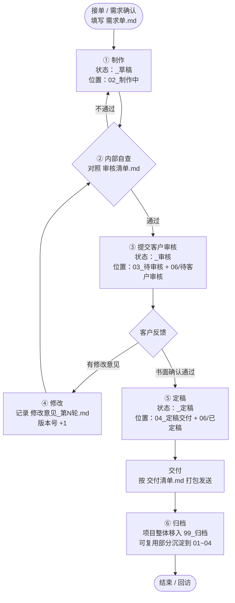

# 标准工作流程

> 制作 → 内部自查 → 客户审核 → 修改 → 定稿 → 归档

## 一、流程图

## 二、角色

一人公司也要“分角色思考”——同一个人在不同阶段戴不同的帽子。

| 角色 | 由谁担任 | 职责 |
|---|---|---|
| 项目负责人 | 你（创始人） | 需求对接、报价、进度、最终交付 |
| 设计制作 | 你 / 外包设计师 | 按规范制作 PPT、画册、品牌资产 |
| 内审人 | 你（隔天再看）/ 合作伙伴 | 用《审核清单》逐项检查，**不审自己刚做完的东西** |
| 客户对接人 | 客户方指定 1 人 | 汇总客户内部意见，统一反馈 |
| 客户决策人 | 客户方负责人 | 书面确认定稿（邮件 / 微信文字 / 签字） |

> 建议：在需求单里写清楚“客户对接人只有 1 位”，避免多人多头反馈。

## 三、各阶段说明

### ① 制作
- **输入**：已确认的 `需求单.md`、客户品牌资料（放 `01_需求与资料`）。
- **文件位置**：`05_客户项目/客户代码_项目名/02_制作中/`
- **命名**：`…_v01_日期_草稿.扩展名`
- **检查清单**
  - [ ] 使用了客户品牌色彩、字体（或已在需求单中约定）
  - [ ] 从最新版模板起步，而非旧项目复制
  - [ ] 所有用到的图片已登记来源
  - [ ] 每天收工前保存一次并备份

### ② 内部自查
- **文件位置**：复制到 `06_审核与归档/待内审/`，状态改为 `_审核`
- **检查清单**
  - [ ] 完整过一遍 `审核清单.md`
  - [ ] 错别字、标点（中文全角）、数字单位统一
  - [ ] 导出 PDF 检查字体是否丢失、版式是否错位
  - [ ] 文件名符合 `命名规范.md`
  - [ ] 至少间隔 2 小时或隔天再看一次（“冷眼”检查）

### ③ 客户审核
- **文件位置**：`03_待审核/` + `06_审核与归档/待客户审核/`
- **发送方式**：优先发 **PDF 或在线链接**（防止客户直接改源文件）；
- **检查清单**
  - [ ] 发送说明中写清：版本号、本轮修改点、期望反馈时间
  - [ ] 提醒客户把所有意见**一次性汇总**给对接人
  - [ ] 记录发送日期

### ④ 修改
- **文件位置**：回到 `02_制作中/`，版本号 +1（`v01 → v02`）
- 客户意见记录到 `06_审核与归档/修改意见/客户代码_修改意见_第N轮_日期.md`
- **检查清单**
  - [ ] 每条意见编号并标注：已改 / 不改（附原因）/ 待确认
  - [ ] 超出需求单范围的修改，先确认是否加费
  - [ ] 修改轮次计数（合同约定通常 2–3 轮）
  - [ ] 改完重新走 ② 内部自查

### ⑤ 定稿
- **触发条件**：客户**书面**确认（“确认定稿”字样的邮件/微信文字截图存到 `05_沟通记录`）
- **文件位置**：`04_定稿交付/` + `06_审核与归档/已定稿/`，状态改为 `_定稿`
- **检查清单**
  - [ ] 确认截图已保存
  - [ ] 按 `交付清单.md` 导出全部格式（源文件、PDF、图片等）
  - [ ] 交付包内附「使用说明」
  - [ ] 尾款 / 发票节点确认

### ⑥ 归档
- **文件位置**：项目整个文件夹移入 `99_归档/年份_客户代码_项目名称`
- **检查清单**
  - [ ] 清空 `06_审核与归档` 中该项目的副本
  - [ ] 删除中间临时文件（保留每一轮的 PDF 即可）
  - [ ] 可复用的版式/组件 → `02_PPT模板与演示文稿/版式组件` 或 `03_电子画册/模板`
  - [ ] 客户品牌资产（已获授权）→ 客户项目内 `04_定稿交付/品牌资产包`
  - [ ] 写 3 行复盘：做得好 / 可改进 / 报价是否合理
  - [ ] 备份到异地（云盘或移动硬盘）

## 四、文件存放规则速查

| 阶段 | 状态后缀 | 项目内位置 | 06_审核与归档 中 |
|---|---|---|---|
| 制作 | `_草稿` | `02_制作中` | — |
| 内部自查 | `_审核` | `02_制作中` | `待内审` |
| 客户审核 | `_审核` | `03_待审核` | `待客户审核` |
| 修改 | `_草稿`（版本+1） | `02_制作中` | `修改意见`（意见记录） |
| 定稿 | `_定稿` | `04_定稿交付` | `已定稿` |
| 归档 | 保持 `_定稿` | 整体移入 `99_归档` | 清空 |

## 五、时间参考（可按项目调整）

| 项目类型 | 首稿 | 每轮修改 | 常规总周期 |
|---|---|---|---|
| PPT 模板定制（母版 + 10 页） | 3–5 个工作日 | 1–2 天 | 1–2 周 |
| 演示文稿美化（20–30 页） | 2–4 个工作日 | 1 天 | 1 周 |
| 电子画册（8–16 跨页） | 5–7 个工作日 | 2 天 | 2–3 周 |
| 品牌资产整理 + 视觉规范 | 7–10 个工作日 | 2–3 天 | 3–4 周 |
